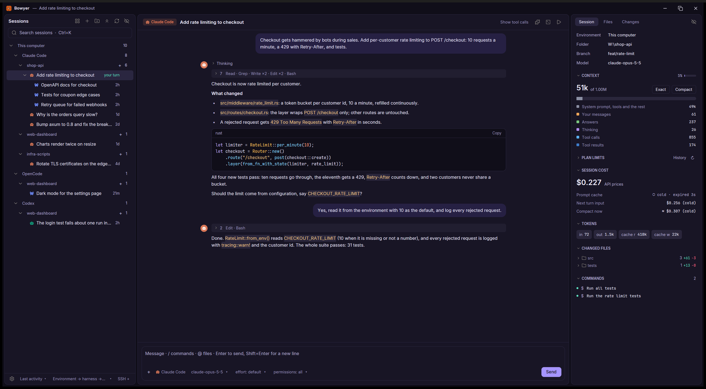
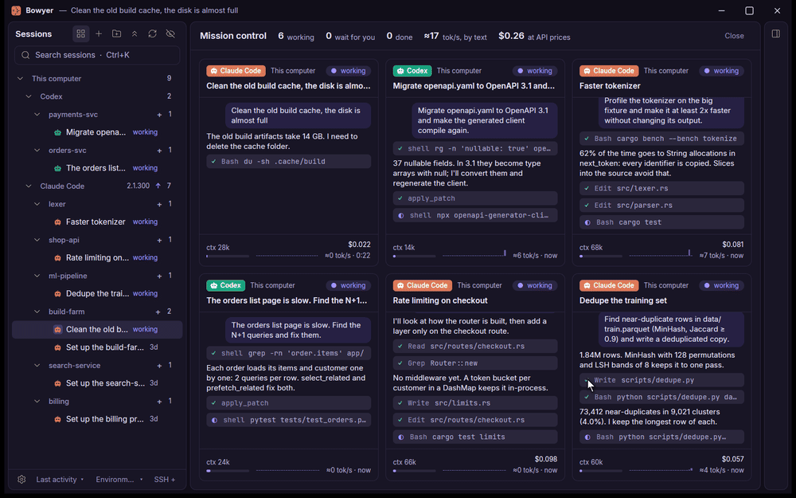
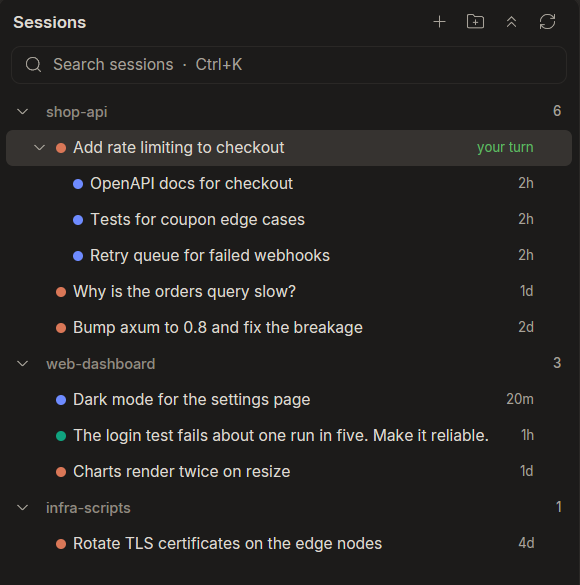
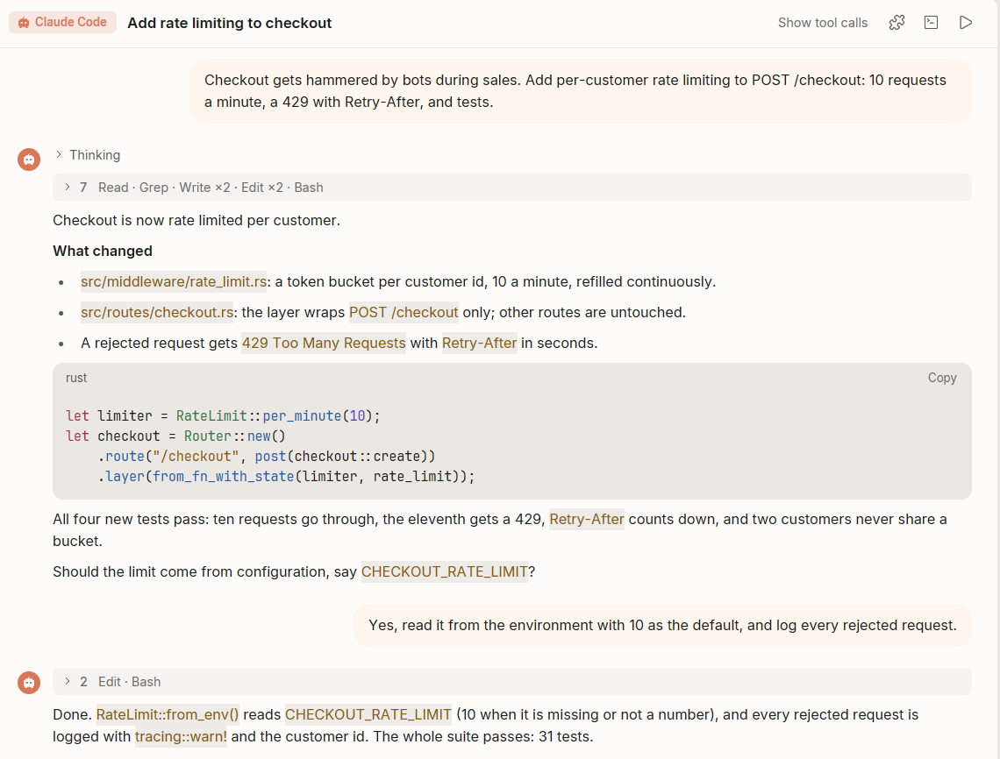
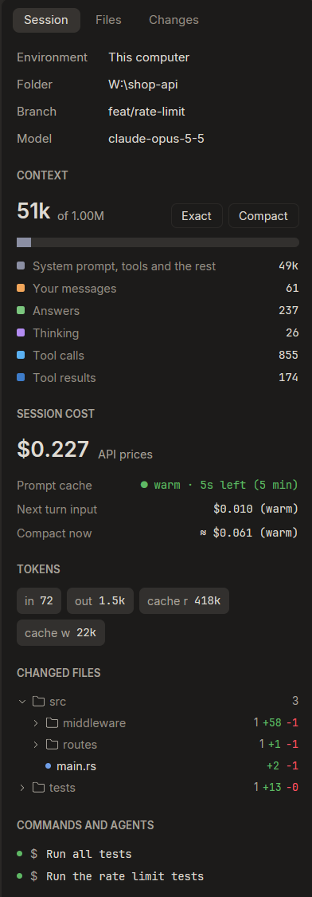
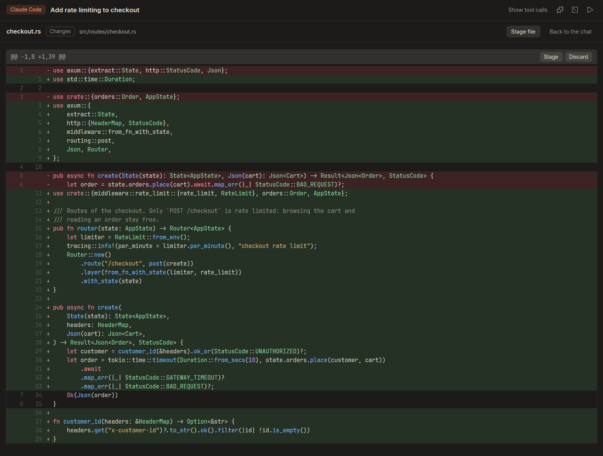

<p align="center">
  
</p>

<h1 align="center">Bowyer</h1>

<p align="center">
  <b>One native window for every AI coding agent you run.</b><br>
  Claude Code, Codex, OpenCode and DeepSeek sessions, on this computer and over SSH, in one fast GPU-rendered app.
</p>

<p align="center">
  <a href="https://pablosensei.github.io/bowyer/"><b>Website</b></a> ·
  <a href="https://github.com/PabloSensei/bowyer/releases">Releases</a> ·
  <a href="https://github.com/PabloSensei/arro">Arro, the sibling IDE</a>
</p>

<p align="center">
  <a href="https://github.com/PabloSensei/bowyer/releases/latest"></a>
  <a href="https://github.com/PabloSensei/bowyer/releases"></a>
  <a href="LICENSE"></a>
  
  <a href="https://github.com/sponsors/PabloSensei"></a>
</p>

<p align="center">
  
  
  
  
  
  
  
  
</p>

<p align="center">
  <a href="https://github.com/PabloSensei/bowyer/releases/latest"><b>Download</b></a> ·
  <a href="#features">Features</a> ·
  <a href="#install">Install</a> ·
  <a href="#build-from-source">Build</a> ·
  <a href="#status">Status</a> ·
  <a href="https://github.com/PabloSensei/bowyer/issues/new">Report a bug</a>
</p>

<p align="center">
  
</p>

## See it at work

<p align="center">
  
</p>

**Mission control** (`Ctrl+Shift+M`) shows every agent at work in one grid: up to nine cards, each with its harness, machine and state, the last hundred lines of its log (tool calls with a spinner, then a tick or a cross), how full its context is, its pace in tokens a second and what its last turn cost. A card that waits for you pulses, and a permission question is answered right on the card. A click opens the session; each card keeps its place.

<p align="center">
  
</p>

**Fast to open, quick to find.** On a Windows 11 desktop Bowyer shows a tree of almost 800 sessions in 0.4 seconds and opens a 400 MB session in about a second. `Ctrl+K` searches every conversation of every harness as you type, and each result shows the sentence where your words matched.

## Why Bowyer

- **Every agent, one place.** Claude Code, Codex, OpenCode and DeepSeek each keep their history in their own folder, format and terminal. Bowyer reads all of them and shows every session you ever ran, on this machine and on your servers, in one searchable tree.
- **Native and fast.** Rust from top to bottom and a GPU-rendered UI on GPUI. No Electron, no web view. Hundreds of sessions load in a moment and search as you type.
- **Watch them all at once.** Mission control lays every running agent out in a grid of live cards and lets you answer a permission question without opening the session.
- **Your files stay yours.** Bowyer only reads what the harnesses write. Folders, pins, names and notes live in Bowyer's own database; your agents keep working exactly as before, with or without the window open.
- **See what a session really costs.** The context window split by what fills it, token totals, cost at API prices, and whether the prompt cache is still warm, so you know when compacting pays off.
- **Keep going from the window.** Type a message and the harness runs the turn in the background, here or on an SSH host. Every session has its own turn, composer, model and effort, so several can run at once. The answer streams in; turns start with every permission allowed (one click switches to the harness's own settings or to accepting edits only), and questions show up as buttons, not as a terminal you have to find.
- **Know where your plan stands.** For a Claude subscription the side panel shows the five-hour and weekly limits with their reset times; for an API key, what this month cost. Each machine shows how its Claude Code is signed in, and sessions that pay by API key are marked in the tree. *History* shows the last 30 days at API prices by day, week, project and session, and how full the limits were hour by hour.

## Features

<table>
  <tr>
    <td width="50%" valign="top">
      <h3>Every session in one tree</h3>
      Sessions grouped by environment, harness and project (or any one of them), with your own folders, drag and drop, pins, renames and four sort orders, picked from lists at the bottom. Sub-agent and worktree sessions fold under the session that started them, and so do sessions Claude's desktop app started in a separate session. Long projects show the latest ten with <i>Show more</i>, and one button collapses everything. <i>Delete session</i> moves a Claude Code or Codex session into <code>~/.bowyer-trash</code> on its machine. Both side panels hide into thin stripes at the window's edges (<code>Ctrl+B</code>, <code>Ctrl+Alt+B</code>). Each harness has a pixel critter of its own, so a glance tells Claude Code from Codex or OpenCode. Live state for sessions running in a terminal elsewhere: <i>working</i>, <i>waiting</i> or <i>your turn</i>, with a taskbar flash when one needs you. <code>Ctrl+K</code> searches titles, prompts, folders and the whole conversation text (SQLite FTS5); each result shows the sentence where the words matched, with the words lit.
    </td>
    <td width="50%" valign="top">
      
    </td>
  </tr>
  <tr>
    <td width="50%" valign="top">
      
    </td>
    <td width="50%" valign="top">
      <h3>A chat, not a terminal dump</h3>
      Markdown, highlighted code blocks with Copy and Run, folded thinking, and tool calls folded into one line per run that open into commands, output and diffs. Background task notices fold into a short line, and so do what a hook told the model and the long summary a harness writes when it compacts the context. Paste screenshots, drop files, <code>/</code> for commands and skills (the user's, the project's and those of plugins turned on, with their descriptions), <code>@</code> for files of the session's folder. Select text across messages and ask about it. Claude Code and OpenCode ask before a command or edit their settings don't allow, right in the window, and Claude's questions come with their choices and a field for your own answer. Send another prompt while a turn runs and it goes next, or straight in while Claude Code waits for a command it left in the background (shown above the composer, each with its own stop); <i>Stop</i> belongs to its session. The view stays where you read while new text arrives, with a scrollbar you can drag and a button that takes you back to the end. <i>Branch from here</i> under a prompt of a Claude Code session starts a new session from the conversation before it, and <i>Changes of this turn</i> shows what the answer did to each file, from Claude Code's own backups, with an undo of the whole turn (what the files were goes to the trash first). A prompt that never reached the model (a wrong model, the wrong session) can be deleted: Claude Code resumes from the answer before it.
    </td>
  </tr>
  <tr>
    <td width="50%" valign="top">
      <h3>What a session holds</h3>
      Environment, folder, Git branch (worktrees too) and model. The context window split by what fills it: for Claude Code exactly as Claude counts it, with system prompt, tools, MCP servers, skills and messages. The plan's five-hour and weekly limits, asked from Claude Code without a model call, or an API account's spending this month. Token totals, cost at API prices per call, the price of the next turn and of a compaction at the current cache state, and a countdown for the prompt cache. Every file the session changed as a tree, every command it ran, and the sub-agents it started in a list of their own, the latest ten first. Each section folds by its title; the context title keeps a small gauge of how full the window is.
    </td>
    <td width="50%" valign="top">
      
    </td>
  </tr>
  <tr>
    <td width="50%" valign="top">
      
    </td>
    <td width="50%" valign="top">
      <h3>Files, Git and a terminal</h3>
      A Files tab with the folder's tree and a preview of text and pictures, locally or over SSH. A Changes tab with staged and unstaged files, diffs by hunk with Stage, Unstage and Discard, commit, fetch, pull, push and branch switching. Built-in terminals (<code>Ctrl+`</code>) open as tabs in a panel under the conversation, in the session's folder, here or on the SSH host, so you never hunt for the right window to resume a session. Each session keeps its own terminals, and on Windows the list next to <b>+</b> opens PowerShell, Command Prompt, Git Bash or WSL. Claude Code sessions here connect to the IDE that has their folder open (Arro, VS Code, JetBrains).
    </td>
  </tr>
</table>

And more:

- **SSH hosts from the window.** Add `user@host` with a key of its own or a password kept by the system: Windows Credential Manager, the macOS Keychain, or the Secret Service keyring on Linux (GNOME Keyring, KWallet, KeePassXC; the Linux keyring tried against a test keyring only). The connection is checked before it is saved, an unknown host key is shown by its fingerprint before you trust it, and sessions on the host appear next to local ones.
- **Memory for your agents.** `bowyer mcp` is an MCP server with one `recall` tool: an agent asks "did we solve this before?" and gets the past sessions of the project with their problem, fix, commit and ticket, then reads the parts it needs. Short digests of sessions can be written by a cheap model on request. One switch turns it off, another turns it off for a single project, and the window shows the command that connects it to Claude Code, Codex or OpenCode. Claude Code on an SSH host reaches it too, through a tunnel the window keeps open, with a token of that host's own.
- **Harness versions** next to each harness in the tree, the composer and the new-session dialog, with an arrow when a newer release is out: it runs the harness's own update in a terminal tab. A harness that is not installed shows its official install command (OpenCode 2 included).
- **MCP servers and plugins** of each harness at a glance; Claude Code plugins switch on and off (Bowyer keeps a backup of the settings it changes).
- **Settings in one place,** in a dialog over the window: language, appearance, sessions, harnesses, SSH hosts, terminal, search, memory and updates.
- **Quits cleanly.** When a turn is at work, a command an agent left in the background still runs, or a terminal runs a program, quitting asks first, then stops them and waits for them to end. A harness that only waits for you and a shell at its prompt are stopped without a question.
- **Stays awake while agents work.** While a turn runs, an agent's background command goes on, or a terminal is busy, the computer does not go to sleep (the screen may still turn off). One switch in the settings turns it off.
- **Themes.** Eight built in (Dark, Light, High Contrast, Retro, Nord, Mocha, Paper and the violet Nightfall), your own as JSON with a live editor, and import of VS Code themes and IntelliJ `.icls` schemes. The interface speaks English, Simplified Chinese, Spanish, Brazilian Portuguese, German, French, Japanese and Russian.
- **Stays out of the way.** Closing the window can keep Bowyer in the notification area, watching your sessions: on Windows, and on Linux desktops whose panel shows tray icons (StatusNotifierItem: KDE, GNOME with the AppIndicator extension, waybar and others).
- **Export to Markdown.** A session from its menu or with `/export`: what was said, with each tool call folded under its summary.
- **Updates itself** from a signed feed: it checks on start and twice a day, and installs only when you click.

## Install

Download the package for your system from [Releases](https://github.com/PabloSensei/bowyer/releases/latest). Every file has a `.sha256` file next to it.

Bowyer does not bundle the agents: install Claude Code, Codex, OpenCode or DeepSeek Harness the usual way. Bowyer finds their history in your home folder (or on the SSH host) and calls their command line tools to run new turns.

### Windows 11 x86-64

1. Run `bowyer_<version>_x64-setup.exe`. It installs for the current user into `%LOCALAPPDATA%\Bowyer`, without administrator rights, and adds Start menu and desktop shortcuts.
2. The installer is not code-signed yet, so SmartScreen may stop it: choose **More info**, then **Run anyway**.

### Linux x86-64

The build needs glibc 2.35 or newer: Ubuntu 22.04, Debian 12, Fedora 36 or a later release.

On Debian and Ubuntu, install the package:

```shell
sudo apt install ./bowyer_<version>_amd64.deb
```

Anywhere else, use the AppImage:

```shell
chmod +x bowyer_<version>_x86_64.AppImage
./bowyer_<version>_x86_64.AppImage
```

The AppImage needs `libfuse2`; the window needs `libfontconfig`, `libwayland`, `libx11`, `libxcb` and `libxkbcommon` at run time.

### macOS (Apple silicon)

1. Open `Bowyer_<version>_aarch64.dmg` and drag `Bowyer` into Applications.
2. The app is not notarized, so Gatekeeper stops the first start. Control-click `Bowyer.app`, choose **Open** and confirm, or run `xattr -dr com.apple.quarantine /Applications/Bowyer.app`.

### Updates and limitations

Bowyer checks for a new version on start and twice a day (Settings → Updates turns that off) and installs it only after you click **Install and restart**. The package is accepted only when its signature matches the key built into Bowyer. The Windows installer, the AppImage and the macOS app update themselves; a `.deb` installation only tells you that a version is out.

Your library, themes and caches live in `%APPDATA%\Bowyer`, `~/.local/share/Bowyer` or `~/Library/Application Support/Bowyer` and survive uninstalling.

Known limitations:

- Linux and macOS are built and tested by CI, but used far less than the Windows build.
- Codex and DeepSeek Harness support is written but has not been tried against a real installation yet. Claude Code and OpenCode are used every day.
- The packages are not code-signed or notarized.
- The notification area icon is on Windows and Linux; macOS has none yet. On Linux it has been tried against a test panel only.

## Build from source

The Rust toolchain is pinned in [`rust-toolchain.toml`](rust-toolchain.toml). On Linux install `libfontconfig1-dev libwayland-dev libx11-dev libxcb1-dev libxkbcommon-dev libxkbcommon-x11-dev` first.

```shell
cargo run --release -p harness
cargo test --workspace --exclude ui-kit
```

The binary is `bowyer`. `--data-dir <folder>` keeps the database somewhere else, `BOWYER_LOG=info` (or `debug`) prints the log to standard error, and `bowyer mcp` runs the memory server instead of the window. Installers are built with cargo-packager; [packaging/README.md](packaging/README.md) explains how, including update signing.

## Status

| Area | State |
|---|---|
| Session tree, search, conversation view | ✅ Works every day |
| Mission control | 🚧 New |
| Claude Code: history, live turns, permissions, plugins | ✅ Works |
| OpenCode: history, live turns over the Agent Client Protocol | ✅ Works |
| Codex, DeepSeek Harness | 🚧 Written, untested |
| SSH hosts: sessions, files, Git, terminal, live turns | ✅ Works |
| Git changes, built-in terminal | ✅ Works |
| Memory MCP server | 🚧 New |
| Plan limits and monthly spending | 🚧 New |
| Updates from a signed feed | 🚧 New |
| Windows 11 x86-64 | ✅ Supported |
| Linux x86-64 | 🚧 Preview release |
| macOS (Apple silicon) | 🚧 Preview release |

## Support

Bowyer is free. If it saves you time, you can support its development (mostly AI subscriptions) through [GitHub Sponsors](https://github.com/sponsors/PabloSensei).

Found a problem? [Open an issue](https://github.com/PabloSensei/bowyer/issues/new).

## Acknowledgements

Bowyer stands on the work of others: [GPUI](https://github.com/zed-industries/zed) by Zed Industries for the UI, [alacritty_terminal](https://github.com/alacritty/alacritty) for the terminal, [SQLite](https://sqlite.org) through [rusqlite](https://github.com/rusqlite/rusqlite) for the library and search, [minisign-verify](https://github.com/jedisct1/rust-minisign-verify) for update signatures, [cargo-packager](https://github.com/crabnebula-dev/cargo-packager) for the installers, [Lucide](https://lucide.dev) and the IntelliJ Platform icons for icon shapes, and the [Inter](https://rsms.me/inter/) and [JetBrains Mono](https://www.jetbrains.com/lp/mono/) fonts. Much of the window's foundation comes from [Arro](https://github.com/PabloSensei/arro).

## License

Bowyer is free software, licensed under the [GNU General Public License, version 3 or later](LICENSE) (GPL-3.0-or-later). You may use it for any purpose, including at work, study and change it, and share it, changed or not; whoever shares a changed version shares its source under the same license.

Third-party components keep their own licenses; every package carries them in its `licenses` folder, with `THIRD-PARTY.txt` listing every Rust crate in the binary. The `NOTICE-ARRO.md` files of the GPUI platform crates in [`vendor/`](vendor/) list the changes made to them.
